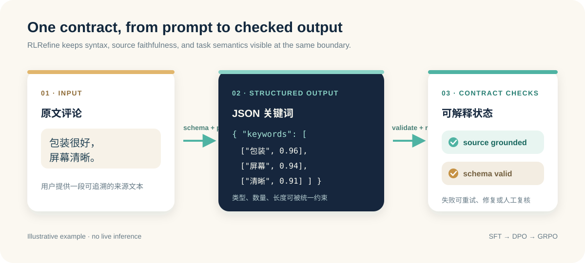

# RLRefine

**Schema-driven extraction. Source-grounded validation.**

English · [简体中文](README_CN.md)

[](https://github.com/xinyuran/RLRefine/actions/workflows/tests.yml)
[](docs/usage.md)
[](LICENSE)
[](https://huggingface.co/xinyuran/Qwen2.5-7B-RLRefine)
[](https://huggingface.co/datasets/xinyuran/RLRefine-Dataset)
[](https://huggingface.co/spaces/xinyuran/RLRefine-Demo)

RLRefine is a Python toolkit for structured LLM extraction, with Chinese
e-commerce review keywords as its main example. It connects task schemas,
inference validation and SFT → DPO → GRPO rewards, so you can inspect both
output structure and explicit source constraints.

**[Try the live model demo](https://huggingface.co/spaces/xinyuran/RLRefine-Demo)** ·
[Run model inference](#run-model-inference) ·
[Evaluation](docs/evaluation.md) ·
[Training recipes](docs/training.md)



## Try it in your browser

Enter a Chinese review in the [live demo](https://huggingface.co/spaces/xinyuran/RLRefine-Demo)
and click **Extract keywords**. The published model generates the keywords;
the page shows source highlights, validation results and the raw response.
No JSON input or local GPU is needed. The demo uses shared ZeroGPU with queues
and daily quotas; reviews are sent to the Space for inference. See the
[deployment details](demo/live/README.md).

## See the contract

For the source `包装很好，屏幕清晰。` (“The packaging is good and the screen is clear”):

```python
from core.target_contract import validate_keyword_payload

source = "包装很好，屏幕清晰。"
payload = {"keywords": [["原文描述屏幕", "屏幕", 0.94]]}
assert validate_keyword_payload(payload, source) == (True, [])

payload["keywords"][0][1] = "续航"  # Battery life is absent from this review.
valid, errors = validate_keyword_payload(payload, source)
assert not valid
print(errors)  # ['keywords[0].keyword_not_in_source']
```

This is a hand-written illustration, not model output. The
[developer contract playground](https://huggingface.co/spaces/xinyuran/RLRefine-Playground) lets you
edit examples and inspect errors without a GPU, API key or model download.
Passing explicit rules does not guarantee relevant or complete extraction.

## What it provides

| Capability | What you can use |
|---|---|
| Task schemas | Field types, enums, lengths, nested structures and JSON Schema export |
| Keyword contracts | Tuple shape, numeric confidence, source substrings, length, count and duplicate checks |
| Inference pipeline | OpenAI-compatible endpoints, retries, post-processing, fallback and explicit error states |
| Post-training recipes | LoRA SFT, DPO and GRPO scripts with structure/source/reference-based rewards |
| Evaluation | Exact-set Macro/Micro-F1, Schema validity and source-missing keyword rates |

The keyword example is the main evaluated use case. A
[support-ticket routing schema](examples/intent_routing/README.md) demonstrates
a different output structure. English task effectiveness and broad domain
generalization have not been established.

## Quickstart: no model required

Python 3.10+:

```bash
git clone https://github.com/xinyuran/RLRefine.git
cd RLRefine
python -m venv .venv
source .venv/bin/activate
python -m pip install -r requirements.txt
python -m scripts.contract_quickstart
```

On Windows PowerShell, activate with `.venv\Scripts\Activate.ps1` instead.
The quickstart checks two hand-written payloads and prints:

```json
{
  "keyword_contract": {"valid": true, "errors": []},
  "routing_schema": {"valid": true, "errors": []}
}
```

To run the browser playground locally, use
`python -m http.server 7860 --bind 127.0.0.1 --directory demo` and open
[localhost:7860](http://127.0.0.1:7860). It validates supplied output; it does not
generate keywords.

## Run model inference

The published [Qwen2.5-7B-RLRefine model](https://huggingface.co/xinyuran/Qwen2.5-7B-RLRefine)
and [synthetic training dataset](https://huggingface.co/datasets/xinyuran/RLRefine-Dataset)
are available on Hugging Face. On a compatible Linux/CUDA machine:

```bash
python -m pip install -r requirements-training.txt
bash scripts/run_vllm.sh 0 8001 xinyuran/Qwen2.5-7B-RLRefine
```

In a second terminal, from the repository root:

```bash
cp examples/keyword_extraction/.env.example examples/keyword_extraction/.env
python examples/keyword_extraction/run.py
```

The example configuration matches port **8001** and model
**xinyuran/Qwen2.5-7B-RLRefine**. If using an existing service, set its endpoint,
model name and credentials in that `.env` file. See the
[usage guide](docs/usage.md) for Windows instructions and result handling.

## Reported results

Preserved historical results on **331 development samples**, under the experiment's
fixed evaluation protocol:

| Stage | Macro-F1 | Schema validity |
|---|---:|---:|
| Base | 0.2490 | 0.4560 |
| SFT | 0.4946 | 0.6737 |
| DPO | 0.5437 | 0.7432 |
| GRPO | 0.5759 | 0.7976 |
| GRPO + offline deterministic repair | 0.6932 | 1.0000 |

On **496 held-out human-reviewed samples**, GRPO achieved Macro-F1 **0.3525**
and Schema validity **0.5524**, compared with DPO's **0.2984** and **0.4738**.
These absolute scores and the development/test distinction matter.

**Repair is a separate stage. Schema validity is not task accuracy.** Historical
deployment gates were not passed. The public release includes a scorer, but not
the full frozen evaluation datasets and predictions. See
[results, methods and reproducibility limits](docs/evaluation.md).

## Explore and contribute

```text
core/        Schemas, inference, keyword contracts and post-processing
rl/          SFT / DPO / GRPO recipes and rewards
examples/    Keyword extraction, routing schema and data formats
evaluation/  Exact-set keyword scorer
demo/        Browser-only contract playground
tests/       CPU checks and browser/Python contract parity
```

Run `python -m unittest discover -v tests`. Node.js 22+ enables the browser
validator parity check; without Node that check is skipped.

Reproducible failure cases, new task examples and evaluation improvements are
welcome. See [CONTRIBUTING.md](CONTRIBUTING.md). If this project helps your work,
a Star makes it easier for others to discover.

[MIT License](LICENSE)
