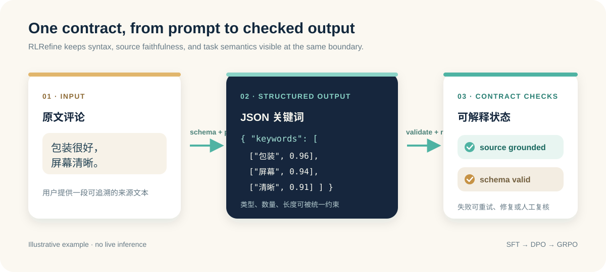

# RLRefine

**面向中文评论的可校验结构化抽取：统一 Schema、原文约束与后训练奖励。**

[English](README.md) · 简体中文

[](https://github.com/xinyuran/RLRefine/actions/workflows/tests.yml)
[](docs/usage.md)
[](LICENSE)
[](https://huggingface.co/xinyuran/Qwen2.5-7B-RLRefine)
[](https://huggingface.co/datasets/xinyuran/RLRefine-Dataset)

RLRefine 是面向大语言模型结构化抽取的 Python 工具包，主要示例为中文电商评论关键词
抽取。项目将任务 Schema、推理校验与 SFT → DPO → GRPO 后训练奖励连接起来，帮助使用者
分别检查输出结构和明确的原文约束。

**[体验合约校验台](demo/README.md)** · [运行模型](#运行模型抽取) ·
[评测与复现范围](docs/evaluation.md) · [训练配置](docs/training.md)



## 先看一个例子

原文：`包装很好，屏幕清晰。`

```python
from core.target_contract import validate_keyword_payload

source = "包装很好，屏幕清晰。"
payload = {"keywords": [["原文描述屏幕", "屏幕", 0.94]]}
assert validate_keyword_payload(payload, source) == (True, [])

payload["keywords"][0][1] = "续航"  # 原文没有提到续航。
valid, errors = validate_keyword_payload(payload, source)
assert not valid
print(errors)  # ['keywords[0].keyword_not_in_source']
```

这是手写教学示例，不是模型生成结果。替换关键词后 JSON 仍可解析，但原文约束失败。
在线校验台可以编辑原文和 JSON、查看匹配高亮与错误；无需 GPU、API Key 或模型下载。
通过这些明确规则，不代表关键词选择完整、相关或置信度已经校准。

## 核心能力

| 能力 | 提供的内容 |
|---|---|
| 任务 Schema | 字段类型、枚举、长度、嵌套结构与 JSON Schema 导出 |
| 关键词合约 | 三元组形状、数字置信度、原文连续子串、长度、数量与去重检查 |
| 推理流程 | OpenAI-compatible 服务、重试、后处理、降级与明确错误状态 |
| 后训练配置 | LoRA SFT、DPO、GRPO，以及结构、原文和参考答案相关奖励 |
| 评测工具 | 关键词精确集合 Macro/Micro-F1、Schema 合法率与非原文关键词比例 |

主任务是中文电商评论。[客服工单路由 Schema](examples/intent_routing/README.md) 展示了
固定字段分类加证据的另一种输出结构；英语任务效果和广泛跨领域泛化尚未建立。

## 快速开始：无需模型

要求 Python 3.10+：

```bash
git clone https://github.com/xinyuran/RLRefine.git
cd RLRefine
python -m venv .venv
source .venv/bin/activate
python -m pip install -r requirements.txt
python -m scripts.contract_quickstart
```

Windows PowerShell 将激活命令替换为 `.venv\Scripts\Activate.ps1`。
quickstart 校验两个手写 payload，不调用模型，预期输出：

```json
{
  "keyword_contract": {"valid": true, "errors": []},
  "routing_schema": {"valid": true, "errors": []}
}
```

本地启动浏览器校验台：

```bash
python -m http.server 7860 --bind 127.0.0.1 --directory demo
```

打开 [localhost:7860](http://127.0.0.1:7860)。该页面校验用户提供的输出，不生成关键词；
教学示例和历史输出节选均有来源说明，输入只在浏览器页面中处理。

## 运行模型抽取

公开模型：[xinyuran/Qwen2.5-7B-RLRefine](https://huggingface.co/xinyuran/Qwen2.5-7B-RLRefine)。
对应合成训练数据：[xinyuran/RLRefine-Dataset](https://huggingface.co/datasets/xinyuran/RLRefine-Dataset)，
包含 `sft`、`dpo`、`grpo` 三种配置。

在兼容的 Linux/CUDA 环境启动服务；这一步可能下载较大的依赖和模型权重：

```bash
python -m pip install -r requirements-training.txt
bash scripts/run_vllm.sh 0 8001 xinyuran/Qwen2.5-7B-RLRefine
```

在第二个终端、仓库根目录运行：

```bash
cp examples/keyword_extraction/.env.example examples/keyword_extraction/.env
python examples/keyword_extraction/run.py
```

PowerShell 复制命令为：

```powershell
Copy-Item examples/keyword_extraction/.env.example examples/keyword_extraction/.env
```

示例环境文件已对应 **8001** 端口和 **xinyuran/Qwen2.5-7B-RLRefine** 模型名。如果连接已有服务，
修改该 `.env` 的地址、模型名和密钥即可。检查返回的 `status`、`fallback` 和错误信息，
不要将降级结果计为模型成功生成。更多说明见 [使用指南](docs/usage.md)。

## 历史评测结果

以下为固定协议下 **331 条开发集**的既有结果，本次文档更新未重新运行模型：

| 阶段 | Macro-F1 | Schema 合法率 |
|---|---:|---:|
| 基座 | 0.2490 | 0.4560 |
| SFT | 0.4946 | 0.6737 |
| DPO | 0.5437 | 0.7432 |
| GRPO | 0.5759 | 0.7976 |
| GRPO + 离线确定性修复 | 0.6932 | 1.0000 |

在 **496 条隔离人工复核样本**上，GRPO 的 Macro-F1 为 **0.3525**、Schema 合法率为 **0.5524**；
DPO 分别为 **0.2984** 和 **0.4738**。历史研究名称 E4 与公开 checkpoint-924 指向同一份权重，
仅命名不同；推理后端、提示和后处理仍影响结果。

**修复属于独立处理阶段，Schema 合法率不等于抽取准确率。** 历史部署门槛未通过，不能据此
声称已具备生产可靠性。公开仓库提供评分器，但不包含完整冻结评测集及历史预测文件，
详见 [完整结果、评分方法和复现范围](docs/evaluation.md)。

## 项目结构与贡献

```text
core/        Schema、推理、关键词合约与后处理
rl/          SFT / DPO / GRPO 配置与奖励
examples/    关键词抽取、路由 Schema 和数据格式
evaluation/  关键词精确集合评分器
demo/        无需模型的浏览器合约校验台
tests/       CPU 测试与浏览器/Python 合约一致性检查
```

运行 `python -m unittest discover -v tests`。安装 Node.js 22+ 后还会执行浏览器校验器一致性测试；
未安装 Node 时该项显示为跳过。

欢迎提交可复现的失败案例、新任务示例和评测改进，见 [贡献指南](CONTRIBUTING.md)。
如果项目对你有帮助，欢迎 Star，让更多开发者发现它。

[MIT License](LICENSE)
